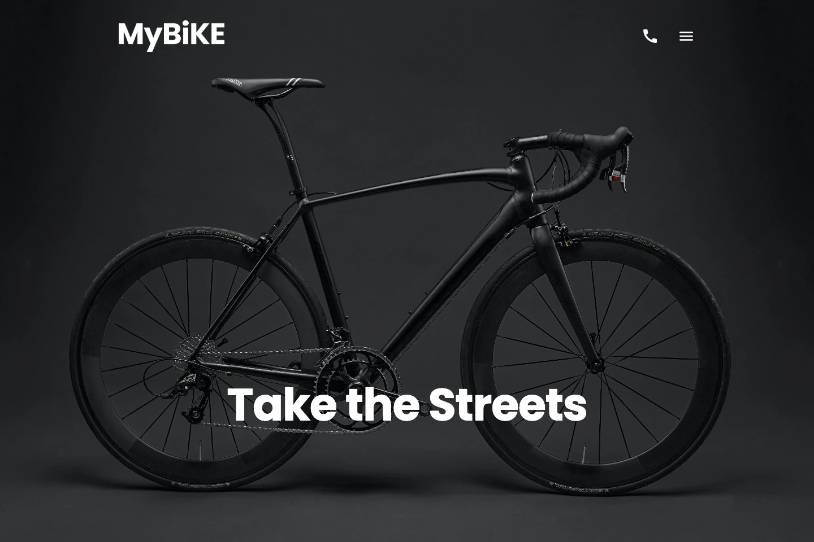
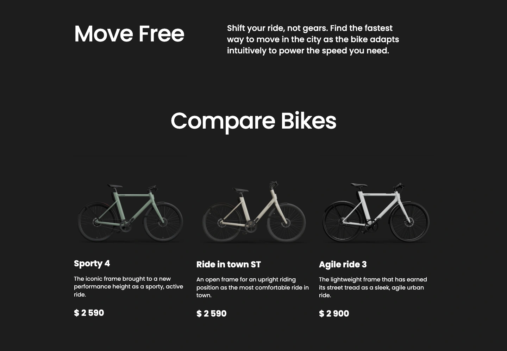
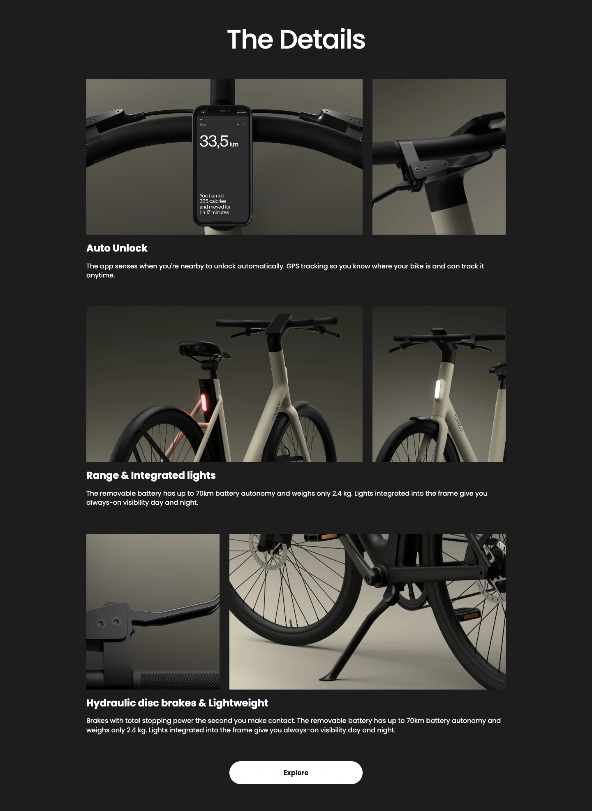
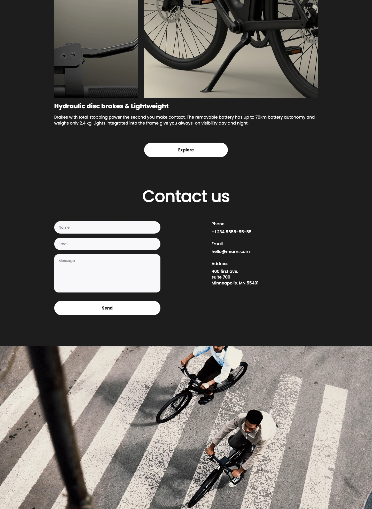
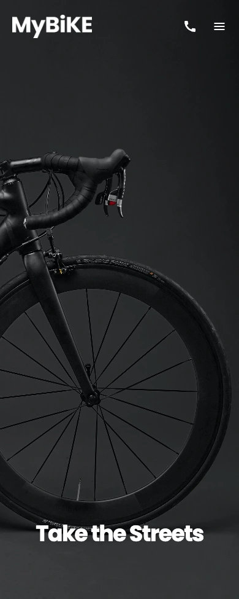
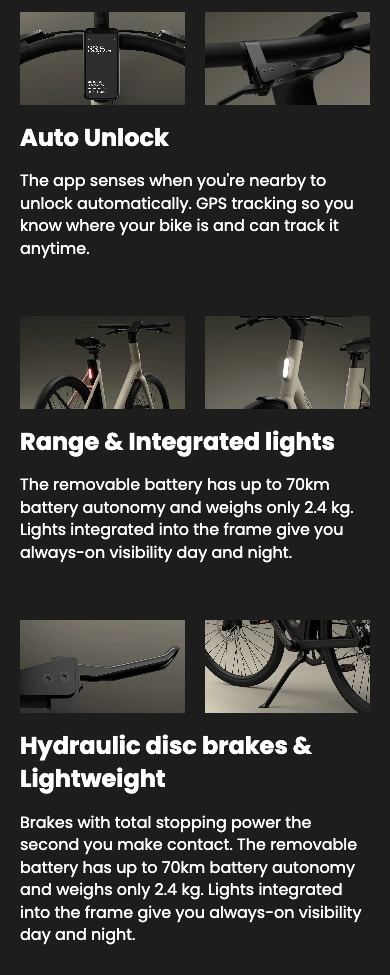
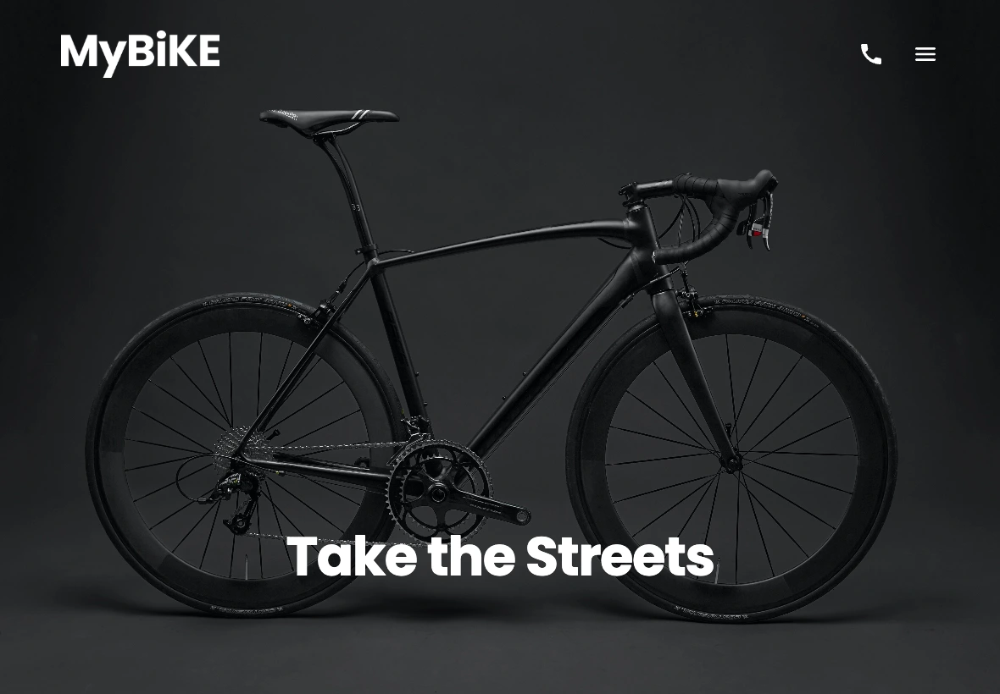
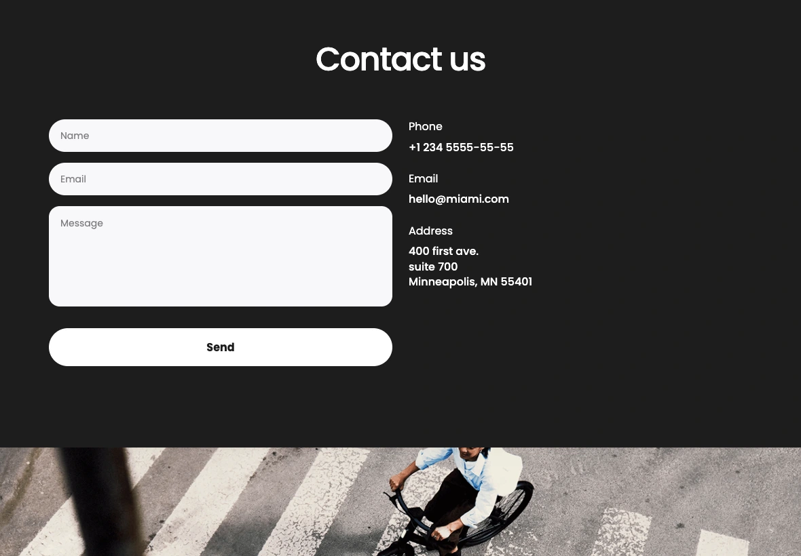

<div align="center">

# MYBIKE

**Take the Streets.**

A responsive urban cycling landing page with a dark interface, bold typography, and a focus on the bikes.
Built with HTML, SCSS, and vanilla JavaScript.

**[Live Demo](https://ivam2280.github.io/mybike-landing-page/)**

**HTML5 · SCSS · JavaScript · Parcel**

[Overview](#overview) · [Screenshots](#screenshots) · [Getting started](#getting-started) · [GitHub Pages](#github-pages) · [Project structure](#project-structure)

</div>

[](docs/screenshots/desktop-hero.webp)

<p align="center"><sub>Desktop preview · 1440 × 960</sub></p>

## Overview

MYBIKE presents a collection of city bikes through a full-screen photographic hero, a three-model comparison, and a gallery of product details. A charcoal background and Poppins typography keep the interface consistent from mobile to desktop.

### Features

- **Responsive layout** — two-column mobile, six-column tablet, and twelve-column desktop grids.
- **Bike comparison** — Sporty 4, Ride in town ST, and Agile ride 3, with descriptions and prices.
- **Feature gallery** — Auto Unlock, Range & Integrated lights, and Hydraulic disc brakes & Lightweight.
- **Full-screen navigation** — section links, smooth scrolling, and page scroll locking while the menu is open.
- **Interactive details** — image hover effects, button shadows, and input hover and focus states.
- **Contact section** — labeled fields with native validation, plus telephone, email, and map links.
- **Production build** — Parcel compiles SCSS and generates relative asset paths for GitHub Pages.
- **Automatic deployment** — a GitHub Actions workflow builds and publishes the site.

The contact form is a front-end demo. A valid submission clears the fields without reloading the page; it does not send a message.

## Screenshots

**8 screenshots · 4 Desktop · 2 Mobile · 2 Tablet**

Click any image to view it at full size. The desktop hero appears above. Section screenshots show the complete selected content; both tablet screenshots use an **1180 × 820 px viewport**.

### Desktop

Captured at a viewport width of **1440 px**.

**Brand introduction & bike comparison**

[](docs/screenshots/desktop-bikes.webp)

<table>
  <tr>
    <th width="50%">Product details</th>
    <th width="50%">Contact</th>
  </tr>
  <tr>
    <td valign="top">
      <a href="docs/screenshots/desktop-details.webp">
        
      </a>
    </td>
    <td valign="top">
      <a href="docs/screenshots/desktop-contact.webp">
        
      </a>
    </td>
  </tr>
</table>

### Mobile

Both images are **390 × 975 px in portrait orientation**. The product detail preview focuses on the three feature galleries and their descriptions.

<table>
  <tr>
    <th width="50%">Hero</th>
    <th width="50%">Product details</th>
  </tr>
  <tr>
    <td align="center" valign="top">
      <a href="docs/screenshots/mobile-hero.webp">
        
      </a>
    </td>
    <td align="center" valign="top">
      <a href="docs/screenshots/mobile-details.webp">
        
      </a>
    </td>
  </tr>
</table>

### Tablet

Both screenshots are **1180 × 820 px**, within the six-column tablet layout.

<table>
  <tr>
    <th width="50%">Hero</th>
    <th width="50%">Contact</th>
  </tr>
  <tr>
    <td valign="top">
      <a href="docs/screenshots/tablet-hero.webp">
        
      </a>
    </td>
    <td valign="top">
      <a href="docs/screenshots/tablet-contact.webp">
        
      </a>
    </td>
  </tr>
</table>

### Responsive design

| Layout  | Screen width      | Grid       | Capture viewport        |
| ------- | ----------------- | ---------- | ----------------------- |
| Mobile  | 320–743 px        | 2 columns  | 390 × 975 px · portrait |
| Tablet  | 744–1259 px       | 6 columns  | 1180 × 820 px           |
| Desktop | 1260 px and above | 12 columns | 1440 × 960 px           |

Breakpoints and colors are defined in [`variables.scss`](src/styles/utils/variables.scss). Shared layout and responsive helpers live in [`mixins.scss`](src/styles/utils/mixins.scss). Styles use the BEM naming convention and are organized by component.

## Tech stack

| Technology         | Role                                                         |
| ------------------ | ------------------------------------------------------------ |
| HTML5              | Page structure, navigation, and accessible form labels       |
| SCSS / Sass        | Component styles, variables, mixins, and shared field styles |
| CSS Grid & Flexbox | Responsive layouts and alignment                             |
| JavaScript         | Contact form submission behavior                             |
| Parcel             | Development server, asset processing, and optimized builds   |
| Prettier           | Source formatting                                            |
| GitHub Actions     | Build and deployment to GitHub Pages                         |

## Getting started

Use **Node.js 24** and npm. The deployment workflow uses the same Node.js version.

### Run locally

Clone or download the repository, open its root directory, and run:

```bash
npm ci
npm start
```

Open **[localhost:3000](http://localhost:3000)**. Parcel rebuilds the site when source files change.

### Production build

```bash
npm run build
```

The generated site is written to `dist/`. Relative asset URLs allow it to run under a repository subdirectory on GitHub Pages.

### Available scripts

| Command          | Description                                               |
| ---------------- | --------------------------------------------------------- |
| `npm start`      | Start the development server on port 3000                 |
| `npm run build`  | Generate an optimized production build in `dist/`         |
| `npm run format` | Format the root HTML and source JavaScript, CSS, and SCSS |

## GitHub Pages

The included [deployment workflow](.github/workflows/deploy.yml) installs dependencies with `npm ci`, builds the site, and publishes `dist/`.

1. Upload the repository contents, including the hidden `.github/` directory and `.gitignore`.
2. Open **Settings → Pages → Build and deployment → Source** and select **GitHub Actions**.
3. Push to `main` or `master`. Alternatively, use **Actions → Deploy to GitHub Pages → Run workflow**.
4. Wait for the deployment to finish. The deployment job and **Settings → Pages** provide the live site URL.

If uploading through the GitHub website hides the workflow directory, use **Add file → Create new file** and enter `.github/workflows/deploy.yml` as the full filename, then paste the workflow contents.

The `docs/` directory contains README screenshots. Build output, installed dependencies, and caches are generated locally or in CI and are excluded through `.gitignore`.

## Project structure

```text
.
├── .github/
│   └── workflows/
│       └── deploy.yml
├── .gitignore
├── .prettierignore
├── index.html
├── src/
│   ├── images/
│   │   ├── details/
│   │   ├── icons/
│   │   ├── products/
│   │   ├── favicon.png
│   │   ├── favicon.svg
│   │   ├── footer.png
│   │   ├── header.png
│   │   ├── logo-dark.png
│   │   └── logo-white.png
│   ├── scripts/
│   │   └── main.js
│   └── styles/
│       ├── blocks/
│       ├── utils/
│       └── main.scss
├── docs/
│   └── screenshots/
├── package.json
├── package-lock.json
├── README.md
└── LICENSE
```

## Author

Developed by **Ivan Tovstukha**.

## License

Distributed under the **GNU General Public License v3.0**. See [`LICENSE`](LICENSE) for details.
